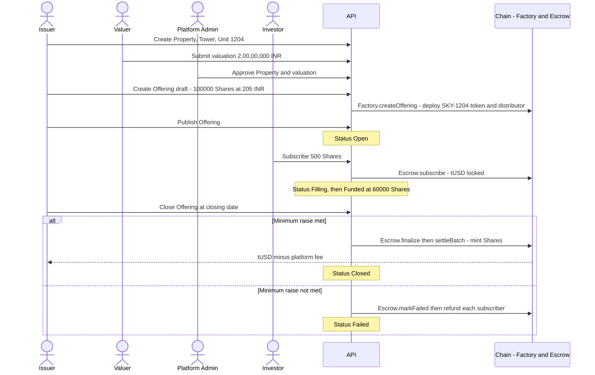
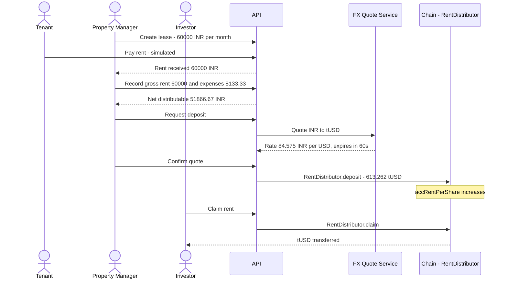
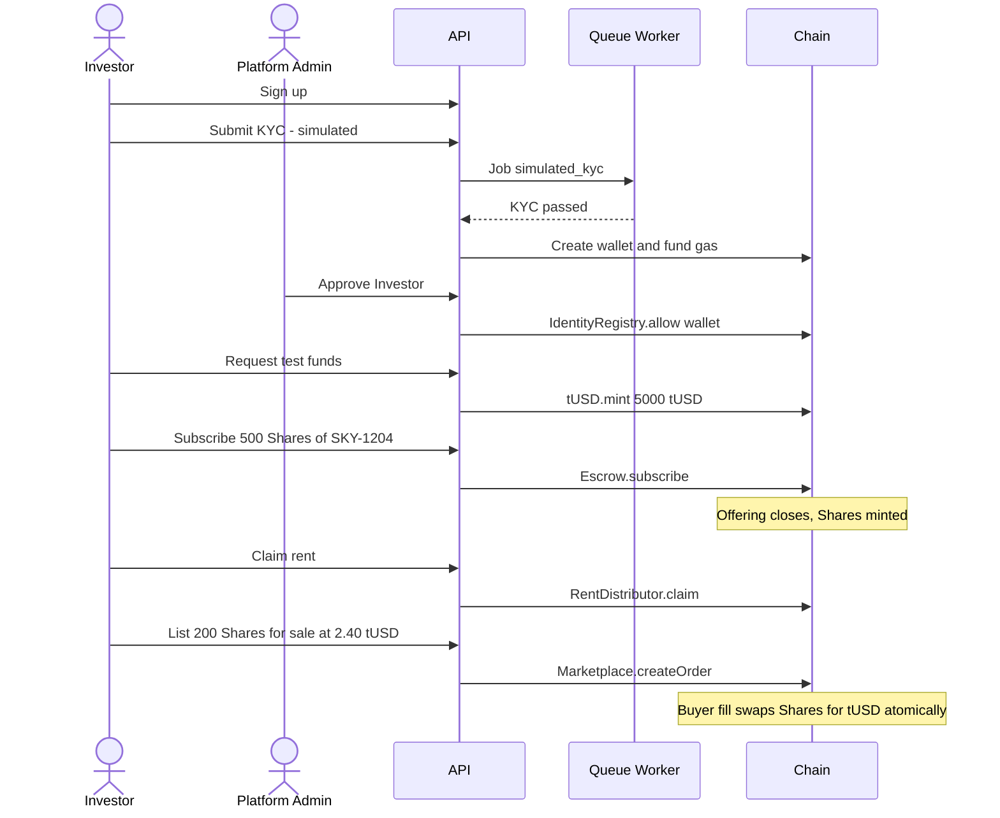

# 01 - Roles and journeys

> **Demo disclaimer:** This is a technical simulation on a local chain (Anvil) or a testnet. It is not a real offering, not investment advice, and moves no real money.

This file defines the six roles and walks through the four main journeys: property to Offering, the tenant rent loop, the Investor path, and admin exceptions. The first three include a sequence diagram. Terms are defined in [00-overview.md](00-overview.md); data structures in [02-domain-model.md](02-domain-model.md).

## Roles

| Role | Can do | Cannot do |
|---|---|---|
| **Investor** | Sign up, complete simulated KYC, get test tUSD, browse Offerings, subscribe, buy/sell on the marketplace, view portfolio, claim rent, export statements | Transfer to non-allowlisted wallets; see other Investors' holdings |
| **Issuer** | Create Property, Tower, Unit; request valuation; create, publish and close Offerings; set price, minimum raise, closing date, fees | Approve its own Property; touch rent money; freeze wallets |
| **Property Manager** | Manage leases; record gross rent and expenses; compute net distributable rent; deposit it into the RentDistributor | Create Offerings; change valuations |
| **Valuer** | Submit a valuation (method, value, report) for a Property or Unit | Approve it; see Investor data |
| **Platform Admin / Compliance** | Approve Investors and Properties; allowlist wallets; freeze wallets; forced transfer with reason; read the audit log; run reports | Edit a valuation or rent record silently (every action is audited) |
| **Tenant** | See the lease; pay rent (simulated) | Anything else |

**Issuer and Property Manager are separate roles even if Radisson plays both.** The Issuer sells the asset; the Property Manager runs it and handles rent. Keeping them apart means a permission, an audit trail and (in a real product) a legal duty each. In the demo seed data one organization holds both roles under two user accounts. See [ADR 0009](adr/0009-separate-issuer-and-property-manager-roles.md).

## Journey (a): property to Offering

Example: Radisson lists flat 1204 in Skyline Towers.

1. **Add property.** Issuer creates Property "Skyline Towers" (SPV, Mumbai, INR), one Tower, and Unit 1204 (2 BHK, floor 12).
2. **Valuation.** Valuer submits ₹2,00,00,000 using comparable sales ([03-pricing-and-fx.md](03-pricing-and-fx.md)). The valuation is attached to the Unit.
3. **Compliance approval.** Platform Admin reviews the Property and valuation, and approves. Real-world legal checks are out of scope and listed as caveats in [00-overview.md](00-overview.md).
4. **Create Offering (Draft).** Issuer sets scope = unit, currency INR, 100,000 Shares, price ₹205 per Share (size ₹2,05,00,000), minimum ticket 500 Shares, minimum raise 60,000 Shares, closing date, rent pool = unit. The factory deploys the `SKY-1204` token and its RentDistributor.
5. **Publish.** Status moves Draft to Open. The Offering appears in the Investor catalog.
6. **Subscribe into escrow.** Investors subscribe; tUSD moves into the Escrow contract. Status is Filling until the minimum raise is reached, then Funded.
7. **Close.** At the closing date (or when sold out):
   - **Minimum raise met:** Shares are minted to subscribers, tUSD (minus platform fee) goes to the Issuer treasury, status Closed.
   - **Not met:** status Failed, every subscriber is refunded the exact amount.

## Journey (b): tenant rent loop

Example: May rent for flat 1204.

1. **Lease.** Property Manager records a lease: Tenant, ₹60,000 per month, start date.
2. **Tenant pays (simulated).** Tenant clicks "Pay rent" and a payment row is created. No money moves; it stands in for a bank transfer. Whether the manager enters this by hand instead is open ([open-questions.md](open-questions.md), Q4).
3. **Manager records gross rent and expenses.** Gross ₹60,000. Expenses: management fee 8% (₹4,800) and maintenance/tax ₹3,333.33 (₹40,000 per year).
4. **Net distributable rent.** ₹60,000 - ₹4,800 - ₹3,333.33 = **₹51,866.67**. The waterfall is in [02-domain-model.md](02-domain-model.md).
5. **Convert and deposit.** The manager requests an FX quote, converts to tUSD (at 84.575 INR per USD after spread: 613.262 tUSD), and deposits once to the RentDistributor. The rate is stored with the deposit ([03-pricing-and-fx.md](03-pricing-and-fx.md)).
6. **Investors claim.** Each holder claims their share. Asha (40,000 Shares, 40%) receives 245.3048 tUSD.

## Journey (c): Investor

1. **Sign up.** Email and password via Auth.js.
2. **Simulated KYC.** Investor enters name and uploads a dummy document. A background job auto-approves it after a short delay (no real checks).
3. **Auto wallet.** The platform creates a custodial wallet and funds it with gas.
4. **Admin approval and allowlist.** Platform Admin approves; the wallet is added to the IdentityRegistry. Until then the Investor can browse but not buy.
5. **Get test funds.** A faucet mints tUSD to the wallet.
6. **Browse.** Catalog of Open Offerings with price, yield, progress.
7. **Buy.** Investor takes an FX quote if the Offering is not in the display currency, then subscribes (primary) or fills a marketplace order (secondary).
8. **Portfolio.** Holdings across Offerings, with asset-currency value, display-currency value and FX gain/loss separately.
9. **Claim rent.** One claim per Offering.
10. **Sell.** List Shares on the marketplace at a price within the band around NAV; a buyer fills the order and the swap is atomic.

## Journey (d): admin exceptions

These are the cases that justify a permissioned token.

1. **Freeze wallet.** Admin freezes a wallet (suspected fraud, KYC expiry). The IdentityRegistry flags it; the token reverts any transfer to or from it. Pending rent stays claimable by the owner unless an admin action says otherwise (open design point, see [05-contracts.md](05-contracts.md)).
2. **Forced transfer / recovery.** Admin moves Shares from one wallet to another with a mandatory reason (for example a court order reference or a verified lost-account claim). The reason hash is emitted on-chain and the full text is stored in the audit log. Worked example in [02-domain-model.md](02-domain-model.md).
3. **Audit log.** Every admin action (approve, allowlist, freeze, forced transfer, valuation change) writes an append-only row: who, what, when, reason, tx hash.
4. **Reports.** Cap table per Offering, rent deposits and claims, investor statements, FX conversions, exception report (frozen wallets, forced transfers). Exports run as background jobs ([04-architecture.md](04-architecture.md)).
