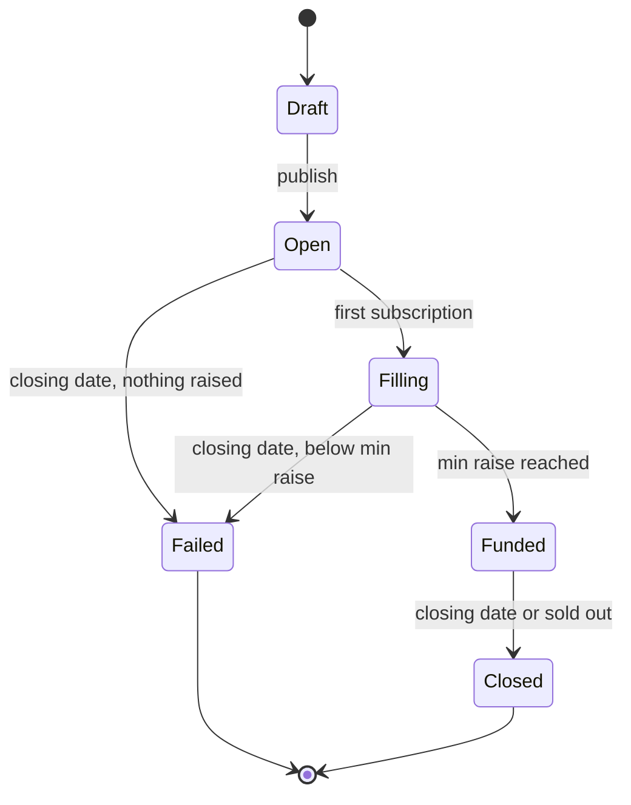
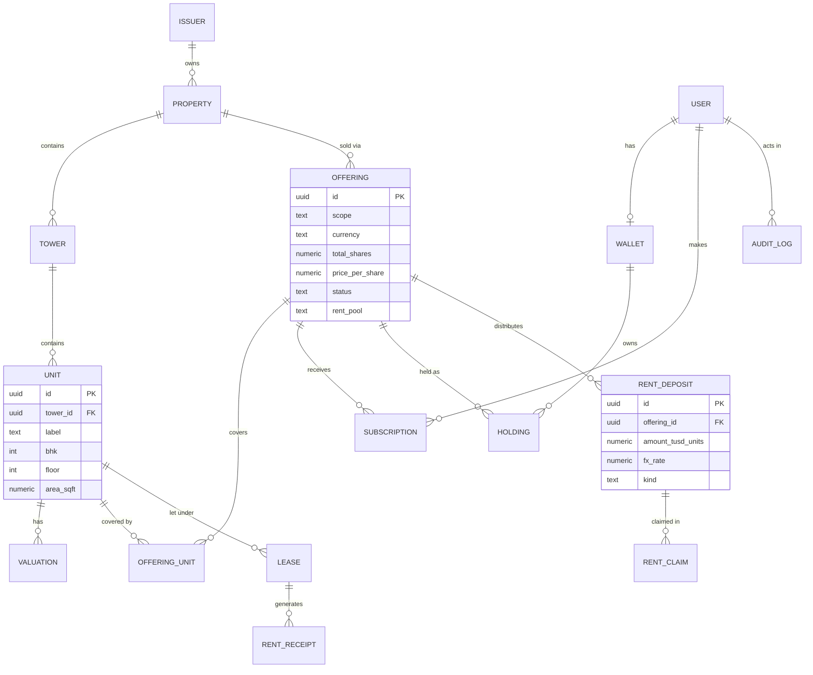
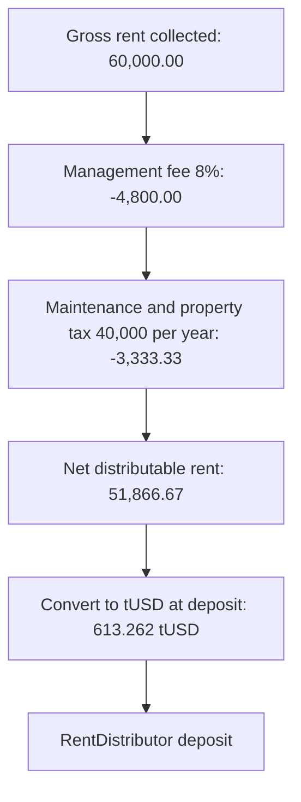

# 02 - Domain model

> **Demo disclaimer:** This is a technical simulation on a local chain (Anvil) or a testnet. It is not a real offering, not investment advice, and moves no real money.

This file defines the hierarchy (Issuer > Property > Tower > Unit), the Offering, how Radisson's real portfolio maps onto them, an ER diagram, a Postgres schema sketch, and eleven edge cases with worked numbers. The schema is a sketch to settle the shape; column details will change during implementation. Money rules apply everywhere: no floats; Postgres `NUMERIC`; on-chain amounts are `uint256`, stored as `NUMERIC(78,0)`.

## Hierarchy

```
Issuer (Radisson)
 └─ Property   (SPV, city, currency)            "Skyline Towers", Mumbai, INR
     └─ Tower  (building or villa cluster)      "Main tower", 32 floors
         └─ Unit (BHK, floor, area, valuation)  "1204", 2 BHK, floor 12, ₹2,00,00,000
```

An **Offering** sits beside this tree and points at one or more Units:

| Field | Example (flat 1204) | Notes |
|---|---|---|
| `scope` | `unit` | `property`, `tower`, `unit` or `bundle` (an arbitrary set of Units) |
| `currency` | INR | The Offering's pricing currency ([03-pricing-and-fx.md](03-pricing-and-fx.md)) |
| `total_shares` | 100,000 | Fixed at creation |
| `price_per_share` | ₹205 | Offering size / total Shares |
| `min_ticket_shares` | 500 | Smallest subscription (₹1,02,500) |
| `min_raise_shares` | 60,000 | Below this at closing, the Offering fails and refunds |
| `closing_date` | e.g. 2026-12-31 | |
| `rent_pool` | `unit` | `unit`, `tower` or `property` (see edge case 4) |
| `fees` | platform fee 1%, management fee 8% | Fee rows, see [03-pricing-and-fx.md](03-pricing-and-fx.md) |
| `status` | Draft | Draft / Open / Filling / Funded / Closed / Failed |

### Offering status

| Status | Meaning |
|---|---|
| Draft | Editable, invisible to Investors, token already deployed or deployable |
| Open | Published, no subscriptions yet |
| Filling | At least one subscription, below the minimum raise |
| Funded | Minimum raise reached; subscriptions still accepted until closing |
| Closed | Finalized: Shares minted, trading and rent live |
| Failed | Closing date passed below the minimum raise; all refunded |



Oversubscription handling (cap at total Shares, or allocate pro rata) is not decided: [open-questions.md](open-questions.md), Q16.

## Radisson portfolio mapping

| Radisson asset | Property / Tower structure | Offering granularity |
|---|---|---|
| 5 single towers (20-50 floors) | One Property, one Tower each | Whole-building Offering, or per-block Offerings (a block is a `bundle` of Units, e.g. floors 1-10) |
| 4 gated communities (5-7 towers, 15-20 floors each) | One Property, 5-7 Towers | Per-tower Offerings, plus an optional whole-community Offering |
| 1 villa community (20 villas: 2, 3 and 4 BHK) | One Property, one villa cluster Tower, 20 Units | Per-villa Offerings, e.g. "Palm Villas V-07" |
| 1 mixed community (villas + 5 towers) | One Property, a villa cluster Tower plus 5 Towers | Per-villa and per-tower Offerings |

Villas have no building, so a villa community gets one Tower row of kind `villa_cluster` (modeling sketch, keeps `Unit.tower_id` non-null). Which levels ship in the MVP is open ([open-questions.md](open-questions.md), Q1). The running example uses a per-unit flat (`SKY-1204`) and a per-villa Offering (`PLM-V07`).

## ER diagram



## Postgres schema sketch

```sql
-- Fiat amounts: NUMERIC(24,2). Share counts and on-chain amounts: NUMERIC(78,0). Never float.

CREATE TABLE issuer   (id uuid PRIMARY KEY, name text NOT NULL);
CREATE TABLE property (
  id uuid PRIMARY KEY, issuer_id uuid NOT NULL REFERENCES issuer,
  name text NOT NULL, spv_name text NOT NULL, city text NOT NULL,
  currency char(3) NOT NULL,                       -- 'INR'
  approval_status text NOT NULL DEFAULT 'pending'  -- set by Platform Admin
);
CREATE TABLE tower (
  id uuid PRIMARY KEY, property_id uuid NOT NULL REFERENCES property,
  name text NOT NULL, kind text NOT NULL,          -- 'tower' | 'villa_cluster'
  floors int
);
CREATE TABLE unit (
  id uuid PRIMARY KEY, tower_id uuid NOT NULL REFERENCES tower,
  label text NOT NULL, bhk int NOT NULL, floor int, area_sqft NUMERIC(10,2),
  current_valuation NUMERIC(24,2)                  -- denormalized from valuation
);
CREATE TABLE valuation (
  id uuid PRIMARY KEY, unit_id uuid NOT NULL REFERENCES unit,
  method text NOT NULL,                            -- comparables | income | replacement
  value NUMERIC(24,2) NOT NULL, debt NUMERIC(24,2) NOT NULL DEFAULT 0,
  valuer_id uuid NOT NULL, as_of date NOT NULL
);

CREATE TABLE offering (
  id uuid PRIMARY KEY, property_id uuid NOT NULL REFERENCES property,
  scope text NOT NULL CHECK (scope IN ('property','tower','unit','bundle')),
  currency char(3) NOT NULL,
  total_shares NUMERIC(78,0) NOT NULL,
  price_per_share NUMERIC(24,6) NOT NULL,
  min_ticket_shares NUMERIC(78,0) NOT NULL,
  min_raise_shares NUMERIC(78,0) NOT NULL,
  closing_date date NOT NULL,
  rent_pool text NOT NULL CHECK (rent_pool IN ('unit','tower','property')),
  status text NOT NULL DEFAULT 'draft',
  token_address text, distributor_address text     -- set after factory call
);
CREATE TABLE offering_unit (
  offering_id uuid REFERENCES offering, unit_id uuid REFERENCES unit,
  PRIMARY KEY (offering_id, unit_id)               -- materialized for every scope
);

CREATE TABLE app_user (id uuid PRIMARY KEY, email text UNIQUE NOT NULL, kyc_status text NOT NULL, approved boolean NOT NULL DEFAULT false);
CREATE TABLE wallet   (id uuid PRIMARY KEY, user_id uuid UNIQUE REFERENCES app_user, address text UNIQUE NOT NULL, encrypted_key bytea NOT NULL, frozen boolean NOT NULL DEFAULT false);

-- Chain-derived tables are written only by the indexer (see 04-architecture.md)
CREATE TABLE holding (offering_id uuid REFERENCES offering, wallet_id uuid REFERENCES wallet, shares NUMERIC(78,0) NOT NULL, PRIMARY KEY (offering_id, wallet_id));
CREATE TABLE rent_deposit (
  id uuid PRIMARY KEY, offering_id uuid NOT NULL REFERENCES offering,
  kind text NOT NULL DEFAULT 'rent',               -- 'rent' | 'sale'
  net_fiat NUMERIC(24,2) NOT NULL, fx_rate NUMERIC(18,8) NOT NULL,
  amount_units NUMERIC(78,0) NOT NULL,             -- tUSD base units (6 decimals)
  tx_hash text NOT NULL, log_index int NOT NULL, UNIQUE (tx_hash, log_index)
);
CREATE TABLE audit_log (id bigserial PRIMARY KEY, actor_id uuid NOT NULL, action text NOT NULL, subject text NOT NULL, reason text, tx_hash text, at timestamptz NOT NULL DEFAULT now());
```

Subscriptions, leases, rent receipts, expenses, claims and the double-entry ledger table follow the same conventions and are listed in [04-architecture.md](04-architecture.md).

## Rent waterfall

Monthly, for flat 1204 (₹ per month):



Vacancy shows up as zero gross rent; costs continue. If net is negative, nothing is deposited and the deficit carries forward (edge case 4).

## Edge cases

All amounts below use flat 1204 unless stated. Rent per month is ₹51,866.67 net, converted to **613.262 tUSD** (6-decimal base units: 613,262,000; 6,132.62 units per Share).

### 1. X investors own one apartment (pro rata)

Five co-owners hold 100,000 Shares. One deposit; each claims `shares / total_supply` of it.

| Investor | Shares | % | tUSD | ≈ INR at deposit rate |
|---|---|---|---|---|
| Asha | 40,000 | 40% | 245.3048 | 20,746.67 |
| Bilal | 25,000 | 25% | 153.3155 | 12,966.67 |
| Chitra | 20,000 | 20% | 122.6524 | 10,373.33 |
| Dev | 10,000 | 10% | 61.3262 | 5,186.67 |
| Esha | 5,000 | 5% | 30.6631 | 2,593.33 |
| **Total** | 100,000 | 100% | **613.2620** | **51,866.67** |

### 2. One investor owns two apartments

Asha also holds 50,000 Shares of `PLM-V07`. Each Offering is its own token and its own RentDistributor, so rent is claimed **per Offering** (two claims, two transactions). The portfolio screen aggregates: total value, total rent claimed, total claimable; "Claim all" queues one claim job per Offering ([06-screens.md](06-screens.md)).

### 3. One investor owns 100% of a unit

Esha buys all 100,000 Shares of `SKY-1204`. She receives 100% of net rent (613.262 tUSD). The token still exists, so she can later sell part of it on the marketplace. Nothing special in the contracts.

### 4. Vacant unit: per-unit pool vs pooled rent

Floor 12 has four units, each with its own Offering (`SKY-1201` to `SKY-1204`), each ₹60,000 rent, each ₹3,333.33 per month in costs. Unit 1203 is vacant this month.

| | `rent_pool = unit` | `rent_pool = tower` (pooled) |
|---|---|---|
| Gross rent | 1201, 1202, 1204: 60,000 each; 1203: 0 | 180,000 combined |
| Management fee 8% | 4,800 each; 1203: 0 | 14,400 |
| Maintenance and tax | 3,333.33 each, including 1203 | 13,333.33 (4 units) |
| Net | 51,866.67 each; **1203: -3,333.33** | 152,266.67 |
| Paid to each Offering | 1201, 1202, 1204: 51,866.67; **1203: 0** (deficit carried) | 38,066.67 each (equal valuation weights) |

Per-unit pools are simple and honest about vacancy; pooled rent smooths it but lets one unit's holders subsidise another's. Pooled allocation happens off-chain (the manager splits net rent into per-Offering deposits); contracts stay per Offering. The default is open: [open-questions.md](open-questions.md), Q2 and Q14.

### 5. Net-rent waterfall

See the diagram above: ₹60,000.00 - ₹4,800.00 - ₹3,333.33 = ₹51,866.67. Tenant security deposits are not income and never enter the waterfall.

### 6. Selling mid-month

Rent uses a **rent-per-share accumulator** ([ADR 0008](adr/0008-rent-per-share-accumulator.md)): each deposit raises a global counter, and each wallet tracks the counter value at its last balance change. A buyer starts at the current counter, so they cannot claim any deposit made before they bought.

- 31 Jan: deposit of 613.262 tUSD. Dev holds 10,000 Shares, has not claimed (61.3262 tUSD pending).
- 10 Feb: Dev sells all 10,000 Shares to Farah. On transfer the contract settles Dev's pending 61.3262 to Dev. Farah starts with 0 pending.
- 28 Feb: deposit of 613.262 tUSD. Farah receives 61.3262; Dev receives nothing from this one.

Limitation: the accumulator pays whoever holds at the deposit moment. Farah gets all of February's rent, including 1-9 Feb when Dev held the Shares. Prorating by day or using a record date is not decided: [open-questions.md](open-questions.md), Q10.

### 7. Rounding dust carried forward

Division can leave remainders at two points, and neither creates or loses money:

- **Per-holder:** pending rent is stored scaled by 10^18, so claims pay whole base units and keep the fraction. If a deposit were 613,262,001 units, Esha's 5,000 Shares are worth 30,663,100.05 units: she claims 30,663,100 and the 0.05 stays in her pending balance for her next claim.
- **Per-deposit:** if total supply does not divide the scaled deposit evenly, the remainder is stored (`dustScaled`) and added to the next deposit. With 100,000 Shares this never happens, but a 30,000-Share Offering would hit it.

### 8. Partial funding

`SKY-1204` has a minimum raise of 60,000 Shares at ₹205.

- **45,000 subscribed at closing:** status Failed. Every subscriber is refunded exactly what they paid; no fee is taken.
- **70,000 subscribed:** status Funded then Closed. 70,000 Shares are minted to subscribers and ₹1,43,50,000 (less platform fee) goes to the Issuer. What happens to the other 30,000 Shares (Issuer retains them, or total supply shrinks to 70,000 and the Offering is downsized) is undecided: [open-questions.md](open-questions.md), Q6 and Q7. The leaning is that the Issuer holds them and receives rent on them, so the 100,000-Share accounting above still holds.

### 9. NAV updates

NAV per Share = (value - debt + reserve) / total Shares. At launch: ₹2,00,00,000 / 100,000 = ₹200 (the Offering price of ₹205 includes costs, see [03-pricing-and-fx.md](03-pricing-and-fx.md)). A new valuation of ₹2,10,00,000 gives NAV ₹210. NAV changes the marketplace band (±10% means ₹189 to ₹231) and portfolio values. It does not change rent accounting or token balances.

### 10. Lost keys and court-order recovery

Wallets are custodial, so "lost keys" means the Investor lost account access. Asha loses access to her login and 2FA. Flow:

1. Platform Admin freezes her wallet.
2. Identity and ownership are verified off-platform (a real process would need legal sign-off; verify with counsel).
3. Admin creates a new allowlisted wallet for the verified Asha and calls `forceTransfer(oldWallet, newWallet, 40000, reasonHash)`. The reason (for example "court order CO-2026-0417") goes in the audit log; its hash is in the `ForcedTransfer` event.
4. Unclaimed rent on the old wallet is moved with an admin claim-to-address action, also logged. This part of the contract design is a proposal: [05-contracts.md](05-contracts.md).

### 11. Property sale and token retirement

Skyline flat 1204 is sold for a net ₹2,10,00,000 after costs. The Property Manager deposits it as a `kind = 'sale'` deposit, converted to tUSD at the day's quote. Each Share is entitled to ₹210; Asha's 40,000 Shares are worth ₹84,00,000. After the deposit the token is marked retired (transfers disabled, no more rent deposits) once holders have claimed. Whether retirement needs a new Offering status or just a flag is open: [open-questions.md](open-questions.md), Q12.
