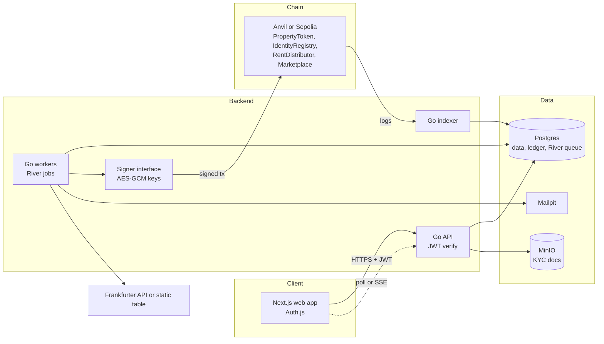
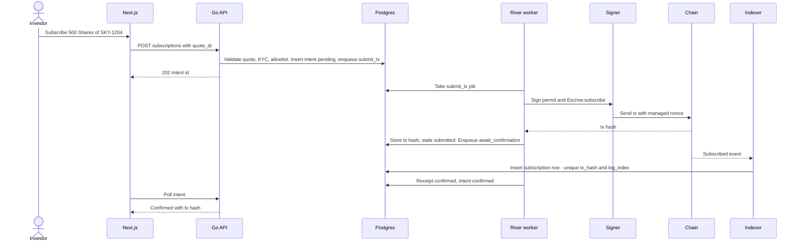
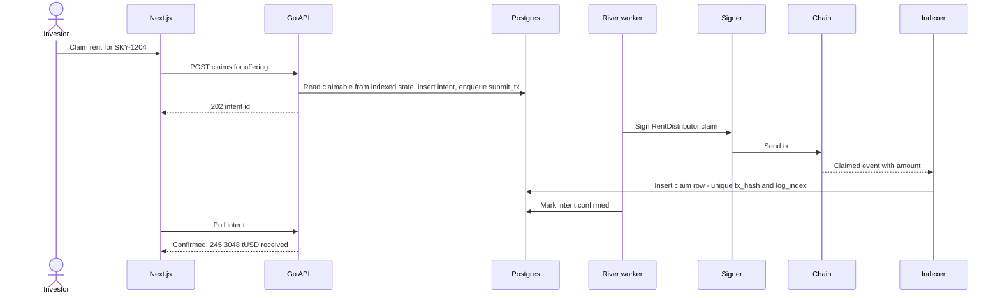

# 04 - Architecture

> **Demo disclaimer:** This is a technical simulation on a local chain (Anvil) or a testnet. It is not a real offering, not investment advice, and moves no real money.

The stack is local-first and open-source: Next.js for the UI, Go for the API, indexer and workers, Postgres for all state and the job queue, Foundry/Anvil for contracts and the chain. `docker compose up` starts everything. This file covers the stack and why, the component and sequence diagrams for "buy Shares" and "claim rent", keys and gas, the indexer rules, and a repo layout. Contracts are in [05-contracts.md](05-contracts.md); the screens that call these APIs are in [06-screens.md](06-screens.md).

## Stack and why

| Layer | Choice | Why |
|---|---|---|
| Web | Next.js + TypeScript, Tailwind, shadcn/ui | One language for UI; shadcn gives accessible components without a heavy design system |
| Backend | Go: API (chi or Echo), indexer, workers; `sqlc` + `pgx`; `go-ethereum` with `abigen` bindings | Typed SQL and typed contract bindings; one static binary per service. [ADR 0002](adr/0002-go-for-api-indexer-workers.md) |
| Contracts | Solidity + Foundry (Anvil, `forge`) + OpenZeppelin | Fast local chain, fuzz and invariant tests built in. [ADR 0004](adr/0004-foundry-and-anvil.md) |
| Database | Postgres | Relational model, transactions, `NUMERIC` money, ledger table. [ADR 0001](adr/0001-postgres-over-mongodb.md) |
| Queue | River (Postgres-backed) | Jobs commit in the same transaction as the data that triggers them. [ADR 0003](adr/0003-river-queue-no-redis-initially.md) |
| Auth | Auth.js issues a JWT; Go verifies it | Standard flows in the UI; the API stays stateless |
| Key storage | AES-GCM encrypted in Postgres, master key from OpenBao or env, behind a `Signer` interface | Simple to run; KMS can replace it later. [ADR 0007](adr/0007-custodial-wallets-for-demo.md) |
| Files | MinIO (S3-compatible) | KYC documents |
| Email | Mailpit | Catch-all SMTP with a web inbox, no real mail |

### Why not MongoDB

Money and ownership are relational and need multi-row atomic updates (deposit + ledger entries + holdings). Postgres gives `NUMERIC` exactness and transactions by default. Details in [ADR 0001](adr/0001-postgres-over-mongodb.md).

### Redis is deliberately skipped

River covers the queue, and the UI can read fresh state from Postgres (polling or SSE fed by `LISTEN/NOTIFY`). Fewer services means a simpler `docker compose`. Add Redis only when measurements justify it:

- API runs as multiple replicas and needs shared rate limiting or WebSocket fan-out.
- A hot read path needs a cache and Postgres tuning is not enough.
- Job throughput exceeds what Postgres-backed queues handle.

## Queue jobs (River)

| Job | Why it needs a queue |
|---|---|
| `submit_tx` | Sign and send a transaction with correct nonce, retry on failure, one sender at a time per wallet |
| `await_confirmation` | Poll for receipt and confirmation depth, then mark the intent confirmed or failed |
| `simulated_kyc` | Delayed auto-approval after a document upload |
| `send_notification` | Email via Mailpit (claim ready, Offering closed, KYC result) |
| `export_report` | Generate CSV/PDF reports without blocking the request |
| `refresh_fx` | Fetch Frankfurter rates on a schedule into the FX table |
| `close_offering_sweeper` | Periodic: find Offerings past closing date and start finalize or refund |

## Components



Rules that keep this simple:

- **The API never signs or sends a transaction inline.** It records an intent and enqueues a job.
- **Only the indexer writes chain-derived tables** (holdings, deposits, claims, subscriptions' on-chain state). The UI shows "pending" from intents and "confirmed" from indexed data.
- **Postgres is the source for off-chain facts** (properties, leases, KYC); the chain is the source for balances.

## Sequence: buy Shares



## Sequence: claim rent



## Indexer

- **Idempotency:** every chain-derived row has a unique key `(tx_hash, log_index)`. Inserts use `ON CONFLICT DO NOTHING`, so replaying blocks is safe.
- **Cursor:** the indexer stores the last processed block per contract set and resumes from there. Each block's rows and the cursor update commit in one transaction.
- **Reorgs:** Anvil does not reorg unless asked. On Sepolia, the indexer processes blocks only after N confirmations (N to be chosen) and, if a stored block hash no longer matches, rolls back rows above the fork point and replays. The demo can start with confirmation depth only and add rollback later.
- **Amounts:** event values are `uint256`, stored as `NUMERIC(78,0)`.

## Keys and signing

- Each Investor wallet is a generated key. The private key is encrypted with AES-GCM and stored in Postgres; the master key comes from OpenBao (dev mode) or an environment variable.
- All signing goes through one Go interface, so a KMS or HSM implementation can replace it without touching callers:

```go
type Signer interface {
    Address(ctx context.Context, walletID uuid.UUID) (common.Address, error)
    SignTx(ctx context.Context, walletID uuid.UUID, tx *types.Transaction) (*types.Transaction, error)
}
```

- Platform roles (Issuer treasury, Property Manager depositor, Admin) use keys managed the same way, with separate signer identities.

## Gas for custodial wallets

- **Anvil:** the wallet-creation job funds each wallet with ETH using `anvil_setBalance`. No real cost.
- **Sepolia:** a **relayer/top-up job** sends a small amount of Sepolia ETH from a funded platform account when a wallet falls below a threshold. Alternatives (paymaster, meta-transactions) are not decided: [open-questions.md](open-questions.md), Q8.

Nonce management: the worker holds a per-wallet lock (a Postgres advisory lock) while it reads the pending nonce, signs and sends, so two jobs for one wallet never collide.

## Docker Compose services

| Service | Image / source | Purpose |
|---|---|---|
| `web` | Next.js | UI |
| `api` | Go | REST API |
| `worker` | Go | River jobs |
| `indexer` | Go | Chain event ingestion |
| `postgres` | postgres | Data and queue |
| `anvil` | Foundry | Local chain |
| `deployer` | Foundry (`forge script`) | Deploys IdentityRegistry, Marketplace, tUSD, Factory; seeds demo data |
| `minio` | MinIO | KYC documents |
| `mailpit` | Mailpit | Email |
| `openbao` | OpenBao (optional, dev mode) | Master key |

## Repo layout (proposal)

```
radisson-fractional/
├─ apps/web/                 # Next.js app
├─ services/
│  ├─ api/                   # cmd/api, cmd/worker, cmd/indexer, internal/...
│  └─ ...                    # sqlc config and generated code
├─ contracts/                # foundry.toml, src/, test/, script/
├─ db/
│  ├─ migrations/            # SQL migrations
│  └─ queries/               # sqlc queries
├─ deploy/docker-compose.yml
├─ docs/                     # this folder
└─ README.md
```
