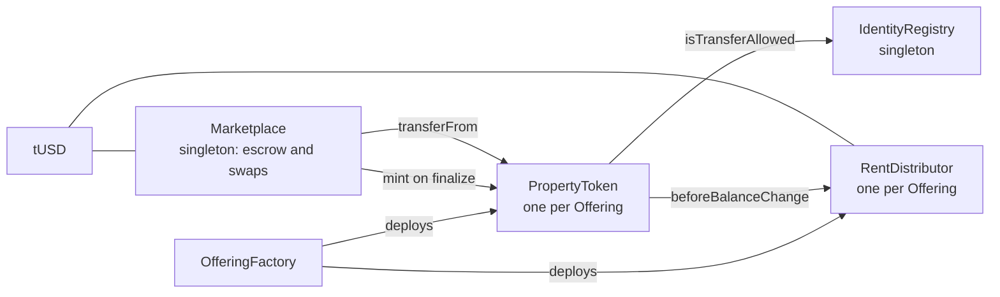

# 05 - Contracts

> **Demo disclaimer:** This is a technical simulation on a local chain (Anvil) or a testnet. It is not a real offering, not investment advice, and moves no real money. The interfaces below are design sketches, not audited code.

A factory deploys one permissioned token (and one RentDistributor) per Offering. Four contracts do the work: `PropertyToken` (the Share), `IdentityRegistry` (allowlist and freeze), `RentDistributor` (rent via a rent-per-share accumulator) and `Marketplace` (primary-sale escrow plus atomic secondary swaps). This file gives each contract's purpose, state, functions, events and permissions, then the invariants to test with Foundry and a worked claim example. Solidity ^0.8.24 with OpenZeppelin is assumed. The platform context is in [04-architecture.md](04-architecture.md).

## Overview



- **Singletons:** IdentityRegistry, Marketplace, tUSD, OfferingFactory.
- **Per Offering:** PropertyToken and RentDistributor, deployed by the factory (clones are an option).
- Amounts are `uint256`. tUSD has 6 decimals; Shares have 0 ([open-questions.md](open-questions.md), Q15).

## IdentityRegistry

**Purpose:** the single allowlist and freeze list for all tokens.

**State**

```solidity
mapping(address => bool) public allowed;   // passed KYC and admin approval
mapping(address => bool) public frozen;    // blocked from any transfer
```

**Interface**

```solidity
interface IIdentityRegistry {
    function isTransferAllowed(address account) external view returns (bool); // allowed && !frozen
    function allow(address account) external;      // COMPLIANCE_ROLE
    function revoke(address account) external;     // COMPLIANCE_ROLE
    function freeze(address account, bytes32 reasonHash) external;   // COMPLIANCE_ROLE
    function unfreeze(address account, bytes32 reasonHash) external; // COMPLIANCE_ROLE
    event Allowed(address indexed account);
    event Revoked(address indexed account);
    event Frozen(address indexed account, bytes32 reasonHash);
    event Unfrozen(address indexed account, bytes32 reasonHash);
}
```

**Permissions:** `COMPLIANCE_ROLE` (Platform Admin). `DEFAULT_ADMIN_ROLE` manages roles.

## PropertyToken

**Purpose:** the Share. ERC-20 with 0 decimals. One per Offering (`SKY-1204`, `PLM-V07`). Transfers revert unless both sender and receiver pass the registry. An admin can force a transfer with a reason.

**State:** ERC-20 balances, `IIdentityRegistry registry`, `IRentDistributor distributor`, `address minter` (the Marketplace), `bool retired`.

**Interface**

```solidity
interface IPropertyToken is IERC20 {
    function mint(address to, uint256 shares) external;            // MINTER_ROLE (Marketplace, at finalize)
    function forceTransfer(address from, address to, uint256 shares, bytes32 reasonHash) external; // FORCE_TRANSFER_ROLE
    function retire() external;                                    // ADMIN: disables transfers after a sale payout
    event ForcedTransfer(address indexed from, address indexed to, uint256 shares, bytes32 reasonHash);
    event Retired();
}
```

**Transfer rule** (OpenZeppelin v5 `_update` hook):

```solidity
function _update(address from, address to, uint256 value) internal override {
    if (from != address(0) && to != address(0)) {            // normal transfer
        require(!retired, "retired");
        require(registry.isTransferAllowed(from), "sender not allowed");
        require(registry.isTransferAllowed(to), "receiver not allowed");
    }
    distributor.beforeBalanceChange(from, to);               // settle pending rent first
    super._update(from, to, value);
}
```

**Mint** requires `to` to be allowed. **`forceTransfer`** skips the sender check (the sender may be frozen or lost) but requires `to` to be allowed and not frozen; it still calls the distributor hook, so pending rent stays attributed to the old address. It emits `ForcedTransfer`. The reason text lives in the off-chain audit log; only its hash is on-chain.

**Permissions:** `MINTER_ROLE` (Marketplace only), `FORCE_TRANSFER_ROLE` (Platform Admin), `DEFAULT_ADMIN_ROLE`.

## RentDistributor

**Purpose:** the Property Manager deposits net rent once per period; each holder claims their share. A rent-per-share accumulator makes transfers during a period safe ([ADR 0008](adr/0008-rent-per-share-accumulator.md)).

**State**

```solidity
uint256 constant PRECISION = 1e18;
IERC20 public immutable tusd;
IPropertyToken public immutable token;
uint256 public accRentPerShare;                 // scaled by PRECISION, only increases
uint256 public dustScaled;                      // remainder carried into the next deposit
uint256 public totalDeposited;                  // tUSD base units
uint256 public totalClaimed;
mapping(address => uint256) public lastAcc;     // accumulator value at holder's last settle
mapping(address => uint256) public pendingScaled; // owed, scaled by PRECISION
```

**Interface**

```solidity
interface IRentDistributor {
    function deposit(uint256 amount, bytes32 kind) external;       // DEPOSITOR_ROLE (Property Manager). kind: RENT or SALE
    function claim() external returns (uint256 paid);               // holder claims for msg.sender
    function claimable(address holder) external view returns (uint256);
    function beforeBalanceChange(address from, address to) external; // only the token
    function adminClaimTo(address holder, address to, bytes32 reasonHash) external; // ADMIN: recovery
    event Deposited(address indexed depositor, uint256 amount, bytes32 kind, uint256 accRentPerShare);
    event Claimed(address indexed holder, uint256 amount);
    event AdminClaimed(address indexed holder, address indexed to, uint256 amount, bytes32 reasonHash);
}
```

**Core logic**

```solidity
function deposit(uint256 amount, bytes32 kind) external onlyRole(DEPOSITOR_ROLE) {
    uint256 supply = token.totalSupply();
    require(supply > 0, "no shares");
    tusd.transferFrom(msg.sender, address(this), amount);
    uint256 numerator = amount * PRECISION + dustScaled;
    accRentPerShare += numerator / supply;
    dustScaled = numerator % supply;                 // carried to next deposit
    totalDeposited += amount;
    emit Deposited(msg.sender, amount, kind, accRentPerShare);
}

function _settle(address a) internal {
    pendingScaled[a] += token.balanceOf(a) * (accRentPerShare - lastAcc[a]);
    lastAcc[a] = accRentPerShare;
}

function claim() external returns (uint256 paid) {
    _settle(msg.sender);
    paid = pendingScaled[msg.sender] / PRECISION;    // whole base units only
    pendingScaled[msg.sender] -= paid * PRECISION;   // keep the fraction
    totalClaimed += paid;
    tusd.transfer(msg.sender, paid);
    emit Claimed(msg.sender, paid);
}
```

`beforeBalanceChange` calls `_settle` for `from` and `to` (skipping the zero address), so a new holder's `lastAcc` is set to the current accumulator before their balance changes. They cannot claim deposits made before they held Shares.

**Permissions:** `DEPOSITOR_ROLE` (Property Manager), `ADMIN` for `adminClaimTo` (reason hash emitted). Whether a frozen wallet may claim is a policy choice noted in [open-questions.md](open-questions.md) with the recovery design (Q10 covers proration; claim-while-frozen is to be decided with the compliance rules).

## Marketplace (escrow and swaps)

**Purpose:** two jobs in one singleton.

1. **Primary sale escrow:** holds subscription tUSD until the Offering finalizes. Minimum raise met -> mint Shares and pay the Issuer. Not met -> refund exactly.
2. **Secondary swap:** atomic Share-for-tUSD exchange between two Investors. The Marketplace never holds Shares: it calls `transferFrom` on the token and on tUSD in one transaction.

### Primary sale

**State** (per token): `minRaiseShares`, `pricePerShareUnits` (tUSD base units), `minTicket`, `closingTime`, `issuerTreasury`, `platformFeeBps`, `state` (Open, Finalized, Failed), `subscribed[address]`, `totalSubscribed`.

```solidity
interface IPrimarySale {
    function configure(address token, SaleParams calldata p) external;       // ISSUER_ROLE via factory
    function subscribe(address token, uint256 shares) external;              // pulls tUSD (permit or prior approve)
    function finalize(address token) external;                               // after closing time or sold out
    function settleBatch(address token, address[] calldata subscribers) external; // mints Shares, bounded batches
    function refund(address token, address subscriber) external;             // anyone may call, pays the subscriber
    event Subscribed(address indexed token, address indexed investor, uint256 shares, uint256 tusdPaid);
    event Finalized(address indexed token, uint256 totalShares, bool success);
    event SharesSettled(address indexed token, address indexed investor, uint256 shares);
    event Refunded(address indexed token, address indexed investor, uint256 tusdReturned);
}
```

- `subscribe` requires the investor to be allowed in the registry, `shares >= minTicket`, and `totalSubscribed + shares <= totalShares` (the oversubscription policy is open, Q16).
- `finalize`: if `totalSubscribed >= minRaiseShares`, state Finalized and the Issuer treasury receives tUSD minus the platform fee; otherwise state Failed.
- Minting happens in `settleBatch` (pull-style in bounded batches, because looping over all subscribers in one transaction can exceed the block gas limit). The backend runs batches as queue jobs.
- `refund` returns exactly `subscribed[subscriber] * price`. No fee on failure.

### Secondary market

```solidity
interface IMarketplace {
    function createOrder(address token, uint256 shares, uint256 pricePerShareUnits) external returns (uint256 orderId); // seller
    function cancelOrder(uint256 orderId) external;                         // seller
    function fill(uint256 orderId, uint256 shares) external;                // buyer, partial fills allowed
    function setNav(address token, uint256 navPerShareUnits, uint16 bandBps) external; // NAV_ROLE
    event OrderCreated(uint256 indexed orderId, address indexed seller, address indexed token, uint256 shares, uint256 priceUnits);
    event OrderFilled(uint256 indexed orderId, address indexed buyer, uint256 shares, uint256 tusdPaid);
    event OrderCancelled(uint256 indexed orderId);
}
```

`fill` runs `token.transferFrom(seller, buyer, shares)` and `tusd.transferFrom(buyer, seller, shares * price)`; either failing reverts both. Both parties must pass the registry check. The seller must have approved the Marketplace for their Shares (the allowlist is checked on seller and buyer, not on the Marketplace). `createOrder` reverts if the price is outside `NAV ± bandBps`, when a band is set. NAV is stored in tUSD units, which drift with FX between updates ([03-pricing-and-fx.md](03-pricing-and-fx.md), [open-questions.md](open-questions.md) Q5 and Q11).

**Permissions:** `NAV_ROLE` (Platform Admin, fed from an approved valuation), `ISSUER_ROLE` for sale configuration via the factory.

## OfferingFactory

`createOffering(OfferingParams)` deploys the `PropertyToken` and `RentDistributor`, grants `MINTER_ROLE` to the Marketplace and `DEPOSITOR_ROLE` to the Property Manager, and configures the primary sale. Callable by `ISSUER_ROLE` after an off-chain compliance approval is recorded. Emits `OfferingCreated(token, distributor, offeringId)` for the indexer.

## Invariants and tests

Written with Foundry: unit tests for each function, fuzz tests for arithmetic, invariant tests with a handler that performs random deposits, claims, transfers, mints and freezes.

| # | Invariant | How to test |
|---|---|---|
| 1 | `totalClaimed <= totalDeposited` always | Invariant handler: random deposits, claims, transfers |
| 2 | Sum of all balances == `totalSupply` | Track holders in the handler; assert after every call |
| 3 | Transfers always revert if sender or receiver is not allowed or is frozen | Fuzz addresses and registry states |
| 4 | A buyer cannot claim rent deposited before they held Shares | Fuzz: deposit, then transfer to a fresh address, assert `claimable(buyer) == 0` |
| 5 | Claims are idempotent: a second `claim()` pays 0 | Fuzz: claim twice, assert second payout is 0 |
| 6 | Escrow refunds return exact amounts (`subscribed * price`), and Escrow tUSD balance after all refunds is 0 | Fuzz subscriptions then fail the sale |
| 7 | No funds stuck: after every holder claims, `totalDeposited - totalClaimed < holders` base units (rounding remainder only) | Invariant after full claim round |
| 8 | `accRentPerShare` never decreases | Invariant |
| 9 | Forced transfer conserves supply and emits `ForcedTransfer` | Unit and fuzz |
| 10 | Atomic swap: Shares and tUSD move together or not at all | Fuzz with a reverting token |

Rounding check for 7: at most one base unit per holder can remain, because claims pay `floor(pending / 1e18)` and keep the fraction.

## Worked claim example

Offering `PLM-V07` (Palm Villas V-07), 100,000 Shares. Three holders. Deposits are rounded to 1,000 tUSD for readability (1,000.000000 tUSD = 1,000,000,000 base units). `PRECISION = 1e18`.

| Holder | Shares |
|---|---|
| Asha | 50,000 |
| Bilal | 30,000 |
| Chitra | 20,000 |

**Deposit 1 (31 Jan): 1,000 tUSD.**
`accRentPerShare += 1,000,000,000 x 1e18 / 100,000 = 1e22` (that is 10,000 base units per Share, 0.01 tUSD).

Nobody has settled, so all `lastAcc` are 0. Claimable now: Asha 500, Bilal 300, Chitra 200 tUSD. Chitra claims 200; Asha and Bilal do not.

**Mid-Feb transfer (10 Feb): Asha sells 10,000 Shares to Dev (new allowlisted wallet).**
`beforeBalanceChange(Asha, Dev)` runs:

- Asha settles: `pendingScaled = 50,000 x 1e22 = 5e26` (that is 500 tUSD in base units x 1e18). `lastAcc = 1e22`. Balance becomes 40,000.
- Dev settles on a zero balance: `pendingScaled = 0`, `lastAcc = 1e22`. Balance becomes 10,000.

Dev holds Shares but has nothing pending from Deposit 1. Asha keeps her 500 tUSD.

**Deposit 2 (28 Feb): 1,000 tUSD.** `accRentPerShare = 2e22`.

| Holder | Shares | Pending from Deposit 1 | New from Deposit 2 | Claimable |
|---|---|---|---|---|
| Asha | 40,000 | 500 (settled at transfer) | 40,000 x 1e22 / 1e18 = 400 | **900** |
| Bilal | 30,000 | 300 | 300 | **600** |
| Chitra | 20,000 | 0 (claimed) | 200 | **200** |
| Dev | 10,000 | 0 | 100 | **100** |

Total claimable 1,800 = total deposited 2,000 - Chitra's earlier claim 200. Invariant 1 holds: claimed (200) <= deposited (2,000), and after everyone claims, claimed = 2,000.

Dev did not receive any of Deposit 1 (invariant 4). The limitation that Dev receives all of February's deposit even though Asha held the 10,000 Shares for 9 days of the month is described in [02-domain-model.md](02-domain-model.md), edge case 6.
